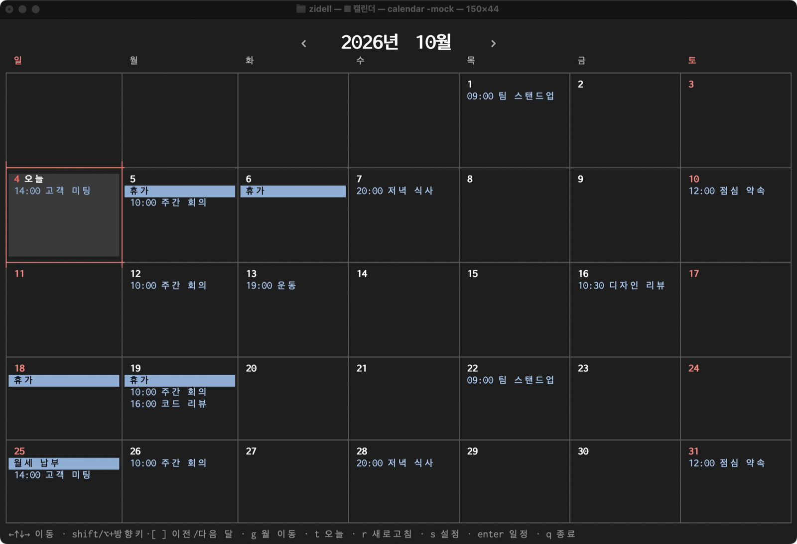

# calendar-tui

[한국어](README.md) · [English](README.en.md)

A lightweight monthly calendar that runs in the terminal. On a Mac it reads and writes the Google and iCloud calendars already registered in macOS, or signs in to Google directly; on Windows it signs in to Google Calendar directly.
Built with Go + [Bubble Tea](https://github.com/charmbracelet/bubbletea) + Lip Gloss.



## Requirements

- macOS 14+ (tuned for Terminal.app) or Windows 10/11 (Windows Terminal recommended).
- Where calendars come from (the backend) is one of two. On a Mac you choose on first launch; Windows uses Google.
  - **Accounts on this Mac (EventKit)**: add Google, iCloud, etc. in System Settings → Internet Accounts. You don't need to use the Apple Calendar app.
  - **Sign in to Google directly**: sign in with your browser. Same on Mac and Windows.

## Install

Mac:

```sh
curl -fsSL https://zidell.github.io/calendar-tui/install.sh | bash
```

Installs the latest release binary (Apple Silicon & Intel) to `~/.local/bin/calendar-tui`, and tells you if `~/.local/bin` isn't on your PATH.

Windows (PowerShell):

```powershell
irm https://zidell.github.io/calendar-tui/install.ps1 | iex
```

Installs the latest release binary (x64 & ARM64) to `%LOCALAPPDATA%\Programs\calendar-tui\calendar-tui.exe` and adds that folder to your user PATH (takes effect in new terminal windows).

Run the same command again to update (settings and sign-in are kept). Website: https://zidell.github.io/calendar-tui/

To uninstall: if you signed in to Google, run `calendar-tui --logout` first; then delete `~/.local/bin/calendar-tui` and `~/Library/Application Support/calendar-tui` on a Mac, or `%LOCALAPPDATA%\Programs\calendar-tui` and `%APPDATA%\calendar-tui` on Windows.

To build from source (needs Go, plus the Xcode Command Line Tools on a Mac):

```sh
git clone https://github.com/zidell/calendar-tui.git
cd calendar-tui && go build -o calendar-tui . && mv calendar-tui ~/.local/bin/
```

Source builds don't include a Google OAuth client. To use Google sign-in, add a client JSON as in "Your own OAuth client" below.

## Run

- Run `calendar-tui` in your terminal. It fills the window; `q` quits.
- On a Mac, the first launch asks where calendars come from (`↑ ↓`, `Enter`). The choice is stored in `config.toml` `[backend] type`; change it there later. If you already have a settings file, it doesn't ask and keeps using the Mac accounts.

### Accounts on this Mac (EventKit)

- On first launch macOS asks to let your terminal access Calendars (the permission belongs to the terminal app you run it from). If access is denied, the app prints instructions and exits. To change it later: System Settings → Privacy & Security → Calendars.
- Saves and deletes are synced to the account (Google, etc.) by macOS.
- Changes made on other devices or apps appear as soon as macOS syncs them into the local calendar database. The app also re-reads when you return to the terminal window and when you press `r`, and once an hour as a fallback. How often macOS fetches from Google is up to macOS.

### Sign in to Google directly

- On first launch your browser opens for Google sign-in (if it doesn't, open the URL printed in the terminal). It's an individually published app, so if you see "Google hasn't verified this app", click **Advanced → Go to calendar-tui** and continue with the calendar permission checked.
- The sign-in token is stored in your OS credential store (macOS Keychain, Windows Credential Manager), not in the settings file.
- Sign in again or switch accounts: `calendar-tui --login`. Sign out (deletes the stored sign-in and asks Google to revoke access): `calendar-tui --logout`.
- Events go directly to and from the Google Calendar API. A month you've already loaded shows instantly and is re-fetched in the background; if something changed, the screen updates. Neighboring months are prefetched. It re-fetches when you return to the terminal window, on `r`, and hourly.
- Google reminders can only fire before the start, so all-day events offer only "Day before, 9am" and "1 week before, 9am".
- Privacy policy: https://zidell.github.io/calendar-tui/privacy.html

#### Your own OAuth client

Release binaries include a default OAuth client (not yet verified by Google, so limited to 100 users). To use your own, enable the Calendar API in Google Cloud Console, create a "Desktop app" OAuth client, save the downloaded JSON as `google_client.json` in the settings folder (the folder of `calendar-tui --config-path`), then run `calendar-tui --login`.

## Screen

- Three views, cycled with `v`. The last view is remembered.
  - **Month**: a calendar filling the screen, with each day's events in its cell. When the window is narrow, the column with the cursor is widened to a minimum width (default 30 characters) and the other columns shrink (never below 5).
  - **Week**: the week as a time grid. Events are placed as blocks at their times and split side by side when they overlap. All-day events sit at the top.
  - **Agenda**: days that have events, listed in order starting from the selected day.
- `‹` `›` beside the large title at the top move by a month (Month view) or a week (Week and Agenda views).
- Timed events use the calendar's color for their text; all-day events fill the whole line with the calendar color. When a cell is full you see `+N more`.
- Weekends and public holidays are red. Holiday and observance names appear next to the date instead of as event lines (holidays in red, observances dimmed).
- Today's cell has a border in the date color (white on weekdays, red on weekends and holidays). The selected day has a gray background.
- Viewing, adding, editing and deleting events happen in windows (modals) over the calendar.
  - `Enter` on a date → that day's event list. `+ New event` is at the top and selected by default. Repeating events show `(weekly)` etc.
  - `Enter` on an event → details (when, repeat, calendar, alert, location, link, notes) with `[Edit] [Duplicate] [Move] [Delete]`. Read-only calendars such as holidays and birthdays can't be edited (but can be duplicated).
  - Link: the URL field, or else the first link in the location or notes (Google Meet, Zoom, ...), opens in your browser with `o` or a click.
  - Add/Edit: title, all day, start/end, repeat (never, daily, weekly, monthly, yearly), alert (none, at start, 5/10/15/30 min, 1 hour, 1 day before; all-day events: 9am on the day, the day before, or a week before), calendar, location, URL, notes. New events default to the calendar you last saved to.
  - Duplicate opens that occurrence as a new non-repeating event in the form. Move changes only the date and keeps the time and length.
  - Editing, deleting or moving a repeating event asks **This event / All future events**.
- **Quick add** (`a`): type one line, e.g. `tomorrow 3pm lunch`, `fri 9:30am standup for 15m`, `oct 20 all day offsite`, or in Korean `내일 오후 3시 치과`, `3일후 오후 3시 회의` (also `3일 후`, `3일 뒤`, `2주 후`), `금요일 10:30-12 리뷰`. No date means the selected day, no time means all day, no length means one hour. Hours 1–7 without am/pm are read as pm. Check the preview and press `Enter` (or `[Add]`), or `[Details]` to continue in the full form.
- **Search** (`/`): titles, locations and notes of events within a year of today. Upcoming events first, then past ones. Picking a result goes to that day and opens its details; `esc` returns to the search.
- Windows that change something only commit when you press their button (`[Save]`, `[Delete]`, `[Go]`, `[Add]`). `esc` always closes without changing anything.
- With a Korean (or other composing) input method active, single-letter shortcuts are held by the input method and never reach the app. Switch to English. The app doesn't change your input source.
- The UI language is Korean or English (follows the system language), and the colors adapt to dark or light terminal backgrounds (change both in Settings → Display).

## Keys

| Screen | Key | Action |
|---|---|---|
| Calendar | `← ↑ ↓ →` / `hjkl` | Move by a day / a week (in Agenda, `↑ ↓` also move by a day) |
| | `[` `]` (`Tab` `Shift+Tab`, `p` `n`, PgUp/PgDn, `Shift`/`Option`+arrows) | Previous / next month (Month) or week (Week, Agenda) |
| | `v` | Switch view: Month → Week → Agenda |
| | `1` `2` `3` | Month · Week · Agenda directly |
| | `a` | Quick add |
| | `/` | Search |
| | `g` | Go to a month (`2026-12`, `202612`, `12` = this year, `2027` = same month) |
| | `t` | Today |
| | `r` | Refresh |
| | `s` | Settings |
| | `Enter` | That day's events |
| | `q` | Quit |
| Any window | `esc` | Close (cancel) |
| | `Tab` | Go to the buttons; keep pressing for the next button, and from the last one back to where you were (`Shift+Tab` backwards, `← →` too) |
| | `Enter` (on a button) / `↑` | Run that button / leave the buttons back to where you were |
| Event list | `↑ ↓` / `Enter` | Select / open |
| | `a` | New event |
| Event details | `← →` / `Enter` | Select / run a button |
| | `e` / `c` / `m` / `d` | Edit / duplicate / move / delete |
| | `o` | Open link |
| Add/Edit | `↓` / `↑` (`Shift+Tab`) | Next / previous field |
| | `← →` `Space` | Toggle all day; change repeat, alert, calendar |
| | `Enter` | Next field (saves on `[Save]`) |
| | `Ctrl+S` | Save from anywhere |
| Quick add | `Enter` | Add right away |
| | `Tab` … `Enter` | `[Add]` or `[Details]` (opens the form filled in) |
| Search | `↑ ↓` / `Enter` | Select / open |
| Delete confirmation | `Enter` / `y` | Delete |
| Settings › Calendars | `Space` `Enter` | Toggle (applied with `[Save]` or `Ctrl+S`) |
| Settings › Display | `← →` `Space` | Change a value (applied with `[Save]` or `Ctrl+S`) |

In a tuidock app, `Cmd+A` also opens Quick Add, just like `a`. Use `a` in a regular terminal.

### Mouse

- Clicking a day other than the selected one just selects it (as if you moved there with the arrow keys). The rest applies to clicks on the selected day.
- Month: an event in the cell → its details. An empty part of the cell → new event on that day. The date line or `+N more` → that day's event list.
- Week: an event block → details, an empty hour → new event at that time, the date line → that day's event list. Agenda: an event line → details, a date line → that day's event list.
- Clicking a shortcut in the help line at the bottom (`a quick add`, ...) is the same as pressing that key. Handy when a Korean (or other) input method swallows single-key shortcuts.
- `‹` `›` beside the title → previous / next (month or week); the title itself → go to a month (`g`).
- Clicking an event, button, setting or search result in a window selects it and presses `Enter`. The link line in the details opens the browser. In the form, click a field to move to it; all day toggles; repeat, alert and calendar step to the next value (click the `‹` side for the previous one).
- Clicking outside the window (the dimmed area) closes it (same as `esc`; unsaved edits are dropped).
- Because the app receives the mouse, turn off View → Allow Mouse Reporting in Terminal briefly if you want to drag-select text (`Cmd+R`).

## Settings

`s` opens the settings menu.

- **Calendars**: turn calendars on and off, grouped by account (Google, iCloud, ...). Turning off an account hides all its calendars. New accounts and calendars are shown by default.
- **Display**: language (auto, 한국어, English), theme (auto, dark, light), week start (Sunday, Monday), time format (24-hour, 12-hour), and the minimum width of the selected day column when narrow (in characters; 0 disables widening).
- Settings file: `~/Library/Application Support/calendar-tui/config.toml` on a Mac, `%APPDATA%\calendar-tui\config.toml` on Windows (print the path with `calendar-tui --config-path`). `[backend]` picks where calendars come from (`auto`, `eventkit`, `google`; restart to apply), `[display]` holds display settings, `[debug]` diagnostics, and `[accounts]` / `[calendars]` have one `"ID" = true/false` line per account and calendar (the comment at the end of the line is its name). Every item has an explanatory comment. You can edit it directly; the running app re-reads it as soon as you save (on Windows, when you return to the window). Check it with `calendar-tui --check-config` (if it's invalid, the app keeps the previous values and shows the error at the bottom of the screen).
- The last view and last-used calendar are remembered automatically and kept separately in `state.json` in the same folder. An old `settings.json` is migrated on first run and kept as `.bak`.
- Follows the [Agent Configuration Accessibility](https://github.com/zidell/agent-configuration-accessibility) convention so AI agents can find and change settings: `calendar-tui --help` and a comment on every item.

## Tips

- Text size: change it with the terminal's `Cmd + +/-` (`Ctrl + +/-` on Windows) or by resizing the window; the calendar re-fits.
- Line spacing can't be changed by the app. Use Terminal.app Settings → Profiles → Text → "Line spacing".
- Key log: set `[debug] key_log = true` in `config.toml` to record keys and clicks in `~/Library/Logs/calendar-tui/keys.log` on a Mac or `%LOCALAPPDATA%\calendar-tui\keys.log` on Windows (only the last 24 hours are kept). Useful to see what reaches the app when a shortcut doesn't work, or whether change notifications (`store changed`) arrive. It records typed text too, so it is off by default.

## License

GPL-3.0. See [LICENSE](LICENSE).
